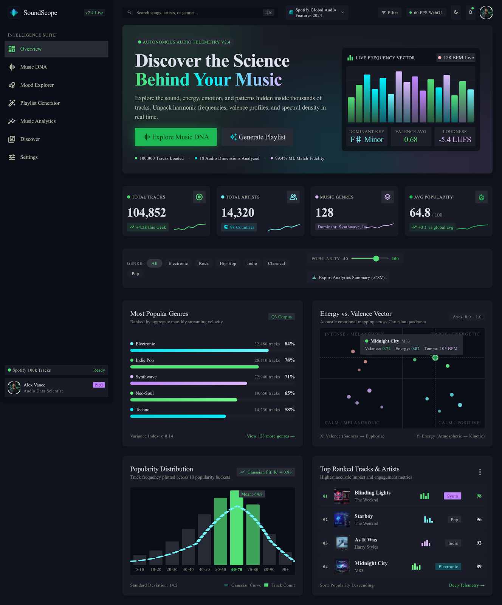
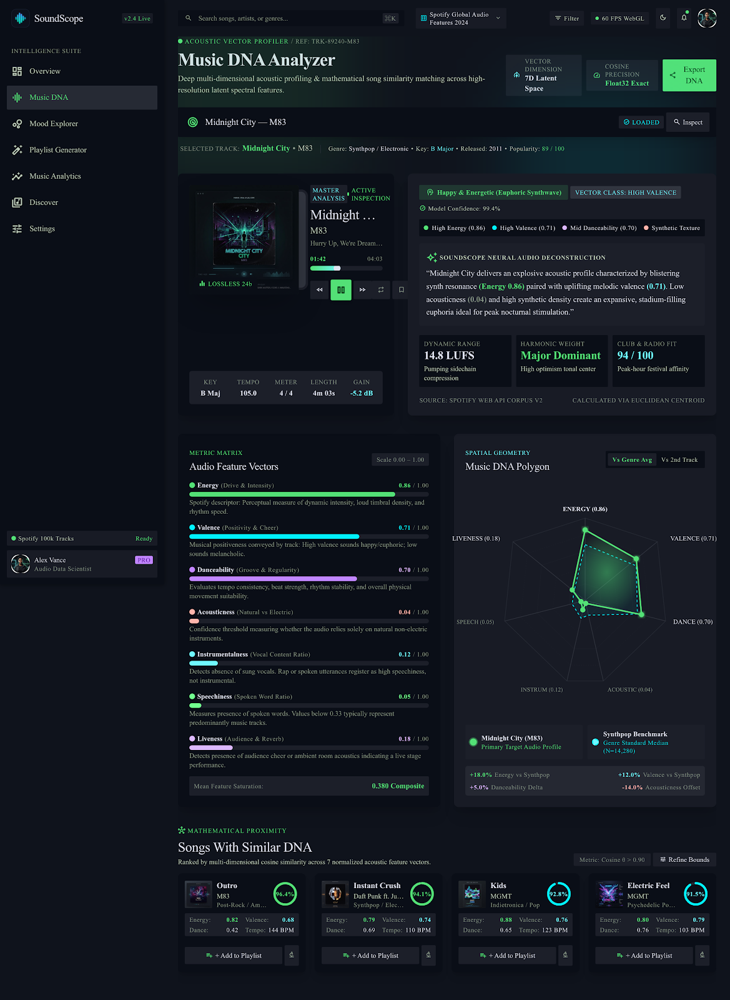
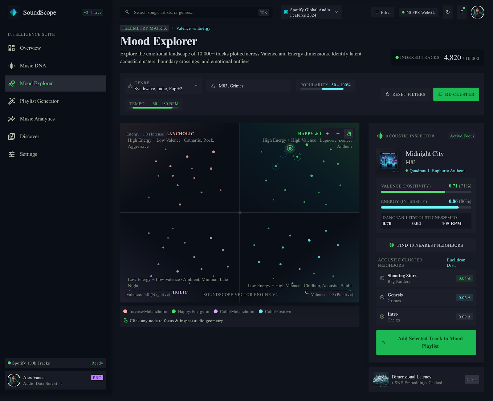
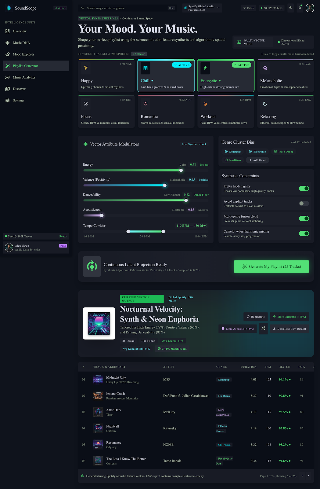

# Mooder — Music Intelligence Platform

[](https://bekuuu1.github.io/Mooder/)
[](https://github.com/bekuuu1/Mooder)
[](LICENSE)

> 🚀 **Live Demo Available**: Experience the application instantly at **[https://bekuuu1.github.io/Mooder/](https://bekuuu1.github.io/Mooder/)**

---

**Mooder** is an interactive audio telemetry and music discovery web platform analyzing 114,000 Spotify tracks across 114 distinct genres. It combines acoustic vector exploration, mood mapping, procedural Web Audio harmonic synthesis, and real-time playlist generation.

---

## 📸 Visual Previews & Modules

### 1. Overview Dashboard
High-level telemetry across the 114,000-track dataset, top hit tracks with audio preview synthesis, and genre distribution.


---

### 2. Music DNA Analyzer
Detailed 5-dimensional acoustic feature breakdown, spinning vinyl turntable preview, key/tempo analysis, and 5-axis radar polygon comparing against genre averages.


---

### 3. Mood Explorer (2D Acoustic Plane)
Interactive 2D Cartesian Quadrant point cloud mapping Energy vs. Valence across 4 emotional zones (Intense, Happy & Energetic, Calm & Sad, Peaceful & Positive) with hover HUD tooltips and nearest neighbor recommendations.


---

### 4. Mood Playlist Generator
Atmosphere-based synthesizer allowing listeners to pick their vibe (Happy, Chill, Energetic, Melancholic, Focus, Workout), fine-tune acoustic sliders, and generate an instant 25-track playlist with audio playback and CSV download.


---

## 🌟 Key Features

- **Live Procedural Synthesizer**: Web Audio API generates ambient harmonic chord pads and bass pulses tuned to any track's musical key and tempo.
- **5-Axis Acoustic Radar Polygons**: Dynamic SVG polygons comparing a song's energy, valence, danceability, acousticness, and instrumentalness directly against its genre benchmark.
- **Fast Interactive Mood Canvas**: 60 FPS HTML5 canvas rendering thousands of acoustic points with zoom, pan, and real-time collision detection.
- **Cosine Proximity Recommendation Engine**: Recommends songs with matching acoustic profiles.
- **Export & Sync**: Download generated playlists as CSV and inspect tracks across all 4 pages with `localStorage` state persistence.

---

## 🚀 How to Run Locally

If you prefer running Mooder on your local machine:

```bash
# 1. Clone the repository
git clone https://github.com/bekuuu1/Mooder.git
cd Mooder

# 2. Start a local HTTP server
python3 -m http.server 3000
```

Open [http://localhost:3000](http://localhost:3000) in your browser.

---

## 📁 Repository Structure

```
mooder/
├── index.html                # Overview Dashboard
├── music-dna.html            # Music DNA Analyzer
├── mood-explorer.html        # 2D Mood Explorer Plane
├── playlist-generator.html   # Mood Playlist Generator
├── css/
│   └── mooder.css            # Obsidian Sonic Intelligence design system
├── js/
│   ├── mooder-audio.js       # Web Audio API procedural harmonic synth
│   └── mooder-shared.js      # Global data loader, command palette (⌘K), & storage
├── data/
│   ├── dataset_stats.json    # Precomputed global telemetry & top tracks
│   ├── genre_benchmarks.json # 7D acoustic medians for 114 genres
│   └── mood_catalog.json     # Fast-indexed 3,500+ tracks catalog
├── assets/
│   └── screenshots/          # Preview screenshots for README
├── scripts/
│   └── prepare_data.py       # Python pipeline processing dataset.csv
├── dataset.csv               # 114,000 Spotify tracks dataset
└── .agents/                  # Stitch Design & Agent Skills
```

---

## 🛠️ Tech Stack

- **Frontend**: Vanilla HTML5, Tailwind CSS, Obsidian Sonic Intelligence theme
- **Audio Engine**: Web Audio API (procedural harmonic pad & bass synthesizer)
- **Data Visualizations**: HTML5 2D Canvas & Dynamic SVG
- **Data Processing**: Python 3 (pandas, numpy)
- **Deployment**: GitHub Pages
